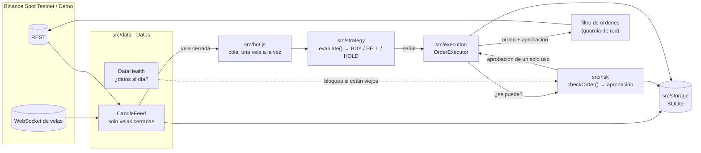
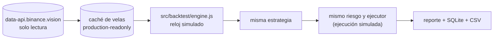
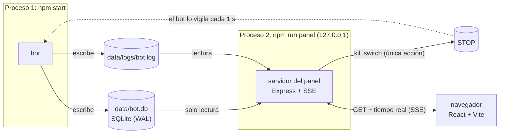

# Binance Spot Bot

Bot de trading para **Binance Spot** escrito en Node.js (ES modules): datos de
mercado en vivo, una estrategia intercambiable, gestión de riesgo obligatoria,
ejecución idempotente de órdenes, registro en SQLite, backtesting sin sesgo de
futuro y un panel web de monitoreo de solo lectura.

> [!WARNING]
> **Proyecto de aprendizaje y portafolio. No es asesoría financiera.**
> Por defecto **solo opera en entornos sin dinero real** (Spot Testnet o Demo Mode
> de Binance) y arranca en **dry-run** (órdenes simuladas). El código se niega a
> conectarse a Binance producción para operar: no existe ninguna opción de
> configuración para hacerlo. La estrategia incluida (cruce de medias) es un
> ejemplo didáctico: en el backtest de ejemplo **pierde dinero**.

## Contenido

- [Qué hace](#qué-hace)
- [Arquitectura](#arquitectura)
- [Requisitos e instalación](#requisitos-e-instalación)
- [API keys (Spot Testnet y Demo) y seguridad](#api-keys-spot-testnet-y-demo-y-seguridad)
- [Configuración](#configuración)
- [Modos: dry-run, testnet y demo](#modos-dry-run-testnet-y-demo)
- [Correr el bot](#correr-el-bot)
- [Gestión de riesgo](#gestión-de-riesgo)
- [Backtest](#backtest)
- [Panel de monitoreo](#panel-de-monitoreo)
- [Lanzador para Windows](#lanzador-para-windows)
- [Pruebas](#pruebas)
- [Problemas comunes](#problemas-comunes)
- [Estructura de carpetas](#estructura-de-carpetas)
- [Decisiones técnicas](#decisiones-técnicas)
- [Créditos](#créditos)

## Qué hace

- Recibe velas por **REST o WebSocket** y entrega a la estrategia **solo velas
  cerradas**, continuas y sin duplicados. Si se corta la conexión, rellena lo perdido.
- Evalúa una **estrategia intercambiable**. La incluida es un cruce de medias
  móviles simples (SMA) con parámetros configurables.
- Cada orden pasa **obligatoriamente** por el **gestor de riesgo**: tope por
  operación, máximo de posiciones, filtros del par, pérdida diaria, kill switch,
  datos desactualizados y reconciliación.
- **Ejecuta** en dry-run (simulado, con comisión y slippage) o en testnet/demo, de
  forma idempotente: nunca reenvía una orden a ciegas.
- **Registra** todo en SQLite (órdenes, ejecuciones, posiciones, eventos,
  velas), separado por entorno, con migraciones versionadas.
- **Backtest** con velas históricas de producción (solo lectura), con los mismos
  módulos que el bot en vivo, período de ajuste y de validación, y resultados
  guardados en SQLite y CSV.
- **Panel web** en `http://127.0.0.1:8787`, en un proceso aparte: estado del bot,
  riesgo del día, gráfico con medias y operaciones, órdenes, logs y backtests, en
  tiempo real. Es de solo lectura; su única acción es el kill switch.
- **Lanzador para Windows**: accesos directos en el escritorio para iniciar y
  detener el bot y el panel en segundo plano (con pm2), ver el estado, activar el
  kill switch y reanudar, sin abrir una terminal.

## Arquitectura



**El flujo, paso a paso:**

1. **Datos** ([src/data](src/data)). `CandleFeed` recibe velas del exchange y las
   guarda en el caché. Solo emite una vela cuando está **cerrada**. `DataHealth`
   vigila que los datos estén al día; `TimeSync` mantiene la hora del servidor; y
   `WeightLimiter` respeta los límites de peticiones (429/418).
2. **Ciclo** ([src/bot.js](src/bot.js)). Cada vela cerrada entra a una **cola** y se
   procesa **de a una**: límites de riesgo → estrategia → orden → límites otra vez.
3. **Estrategia** ([src/strategy](src/strategy)). Recibe las últimas velas cerradas y
   devuelve una señal. No sabe nada de dinero ni de órdenes; por eso el mismo
   código sirve en vivo y en el backtest.
4. **Riesgo** ([src/risk](src/risk)). Decide si la orden se puede enviar. Si la
   aprueba, emite una **aprobación infalsificable y de un solo uso**, atada a esa
   orden exacta.
5. **Ejecución** ([src/execution](src/execution)). Guarda la orden como `pending`
   **antes** de enviarla y la envía con la aprobación. Un **filtro de red** en el
   cliente bloquea cualquier orden sin aprobación. Después registra las
   ejecuciones y actualiza la posición.
6. **Almacenamiento** ([src/storage](src/storage)). SQLite con migraciones
   versionadas. Cada registro indica su entorno (`testnet`, `demo`,
   `production-readonly`) y su modo (`dry-run`, `exchange`). Los entornos nunca
   se mezclan en consultas ni reportes. Antes de aplicar una migración a una base
   que ya tiene datos, se guarda una **copia de seguridad** en `data/backups/`; si la
   copia falla, no se migra.
7. **Estado para el panel.** El bot guarda su estado (arranque, heartbeat, última
   vela, apagado) en la tabla `bot_status`. El [panel](#panel-de-monitoreo) lo lee
   en otro proceso, sin tocar nada del bot.

**El backtest** reutiliza la misma estrategia, el mismo riesgo y el mismo ejecutor,
sobre datos históricos:



## Requisitos e instalación

- **Node.js 22.12 o superior** (probado con Node 24). Recomendado: la versión LTS actual.
- **npm** (viene con Node).
- **git** (opcional, para clonar).
- Sin API keys puedes correr el bot en dry-run, el monitor de datos, el backtest y el panel.

```bash
git clone <url-del-repositorio> binance-spot-bot
cd binance-spot-bot
npm install
cp .env.example .env      # en PowerShell también funciona "cp"
npm test                  # verifica que todo funcione
npm start                 # arranca en dry-run contra el Spot Testnet
npm run panel             # (en otra terminal) panel en http://127.0.0.1:8787
```

En Windows puedes evitar las terminales: después de `npm install` y de crear el
`.env`, haz doble clic en `launcher\windows\instalar-accesos-directos.bat` (ver
[Lanzador para Windows](#lanzador-para-windows)).

No hacen falta herramientas de compilación: `better-sqlite3` trae binarios
precompilados para Windows, macOS y Linux. El archivo [.npmrc](.npmrc) del proyecto
(`ignore-scripts=true`) evita que npm intente compilarlo igual y, de paso, que
alguna dependencia ejecute código al instalarse. Si la instalación fallara,
revisa [Problemas comunes](#problemas-comunes).

## API keys (Spot Testnet y Demo) y seguridad

Solo hacen falta para **enviar órdenes** al testnet o al demo (`DRY_RUN=false`).
**Las keys de un entorno no sirven en otro**: las del testnet no funcionan en demo,
y ninguna de las dos sirve en Binance real (ni al revés).

### Spot Testnet (`BINANCE_ENV=testnet`)

No requiere cuenta de Binance.

1. Entra a <https://testnet.binance.vision> y elige **Log In with GitHub**.
2. Genera una key **HMAC-SHA-256**. Es la más simple: Binance te entrega la API key
   y el secret. El testnet también acepta RSA y Ed25519, pero este bot espera un
   secret de una sola línea.
3. Copia la **API key** y el **secret** a tu `.env`. Guarda el secret en ese momento:
   después no se vuelve a mostrar.

El testnet no tiene retiros ni billetera (sus endpoints `/sapi` no existen), y sus
keys no tienen opciones de permisos. Si consultas la cuenta verás
`canWithdraw: true`: es un indicador de la cuenta, no un permiso de la key.

El testnet regala saldos de varias monedas y **se reinicia aproximadamente una vez
al mes**: se borran los saldos y las órdenes. Después de un reinicio, la
reconciliación del bot detectará la diferencia (ver [Problemas comunes](#problemas-comunes)).
Sus precios son **independientes del mercado real** y tiene poca liquidez.

### Demo Mode (`BINANCE_ENV=demo`)

Requiere una cuenta de Binance, pero no la verificación de identidad (KYC).

1. Inicia sesión en Binance y entra a **Demo Trading** (<https://demo.binance.com>).
2. Arriba a la derecha, icono de cuenta → **API Management** → **Create API**, y
   ponle un nombre.
3. Configura los permisos (ver abajo) y copia la API key y el secret a tu `.env`.

Sus precios y su libro de órdenes son **parecidos al mercado real**. Los saldos
virtuales se reinician a mano desde la interfaz.

### Recomendaciones de seguridad

- **Las keys van solo en `.env`.** Nunca en el código, en issues ni en capturas de pantalla.
- **Nunca subas `.env` a git.** Ya está en `.gitignore`: antes de cada commit revisa
  `git status` y confirma que no aparezca.
- **Sin permiso de retiro.** Activa solo lectura y trading Spot. Este bot nunca
  necesita retirar fondos.
- **Restringe por IP** si el entorno lo permite: solo tu IP podrá usar la key.
- **Una key por uso** (bot, pruebas manuales…). Si se filtra, revócala y crea otra.
- El bot **nunca muestra los secretos** en los logs: aparecen como `[REDACTED]`, y al
  arrancar solo informa si hay credenciales configuradas.
- **Antes de subir el repositorio** (aunque sea privado), confirma que `.env` y
  `data/` están ignorados y que ningún commit los incluye:

  ```bash
  git check-ignore -v .env data/          # debe mostrar la regla de .gitignore de cada uno
  git log --all --name-only --pretty=format: | sort -u | grep -E "^\.env$|^data/|\.db$"   # debe salir vacío
  ```

  Si alguna vez subiste una key por error, **revócala** en el exchange y crea otra:
  borrarla del repositorio no la vuelve secreta otra vez.

## Configuración

Todo se configura en `.env` (plantilla: [.env.example](.env.example)). Los
valores se validan al arrancar: si alguno es inválido, el bot no arranca y lista
todos los problemas juntos. Una línea vacía (`CLAVE=`) usa el valor por defecto.

| Variable | Descripción | Por defecto | Ejemplo |
|---|---|---|---|
| `BINANCE_ENV` | Entorno: `testnet` o `demo`. **No existe opción para producción.** | `testnet` | `demo` |
| `BINANCE_API_KEY` | API key del entorno elegido. Obligatoria si `DRY_RUN=false`. | — | `tu-api-key` |
| `BINANCE_API_SECRET` | Secret de esa key. Obligatorio si `DRY_RUN=false`. | — | `tu-secret` |
| `DRY_RUN` | `true`: órdenes simuladas. `false`: se envían al entorno. Hay que escribir exactamente `true` o `false`. | `true` | `false` |
| `SYMBOL` | Par a operar, formato `BASE/USDT`. | `BTC/USDT` | `ETH/USDT` |
| `TIMEFRAME` | Intervalo de las velas: `1m 3m 5m 15m 30m 1h 2h 4h 6h 8h 12h 1d`. | `15m` | `1h` |
| `DATA_FEED` | Fuente de velas: `rest` (consultas periódicas) o `ws` (WebSocket). | `rest` | `ws` |
| `DATA_STALE_AFTER_SECONDS` | Segundos sin datos (o sin la última vela cerrada) para considerarlos desactualizados y bloquear órdenes. Entre 5 y 3600. | `60` | `120` |
| `STRATEGY` | Estrategia activa. **Obligatoria.** | — | `sma-cross` |
| `STRATEGY_PARAMS` | Parámetros de la estrategia, en JSON de una línea. Los que no pongas usan su valor por defecto. | `{}` (sma-cross: 9/21) | `{"fast":9,"slow":21}` |
| `MAX_TRADE_USDT` | Monto máximo por compra, en USDT (incluye comisión y slippage estimados). | `50` | `25` |
| `MAX_DAILY_LOSS_USDT` | Pérdida máxima del día UTC, neta de comisiones. Al alcanzarla, el bot se detiene. | `20` | `10` |
| `MAX_OPEN_POSITIONS` | Máximo de posiciones abiertas a la vez (entero ≥ 1). | `1` | `2` |
| `KILL_SWITCH_FILE` | Archivo cuya existencia detiene el bot. | `./STOP` | `./PARAR` |
| `FEE_RATE` | Comisión por operación (dry-run y backtest). Entre 0 y 0.01. | `0.001` (0.1%) | `0.00075` |
| `SLIPPAGE_BPS` | Slippage estimado en puntos básicos (dry-run y backtest). Entre 0 y 500. | `5` (0.05%) | `10` |
| `BACKTEST_CAPITAL` | Capital inicial del backtest, en USDT. | `20` | `100` |
| `SHUTDOWN_TIMEOUT_SECONDS` | Al apagar, espera máxima a la operación en curso. Entre 1 y 600. | `30` | `60` |
| `HEARTBEAT_SECONDS` | Cada cuánto se registra el estado del bot. Entre 5 y 3600. | `60` | `300` |
| `LOG_LEVEL` | Nivel de log: `trace debug info warn error fatal silent`. | `info` | `debug` |
| `LOG_FILE` | Archivo de log (JSON, una línea por evento). | `./data/logs/bot.log` | `./logs/bot.log` |
| `DB_PATH` | Base de datos SQLite. | `./data/bot.db` | `./data/testnet.db` |
| `PANEL_PORT` | Puerto del [panel](#panel-de-monitoreo) (entre 1024 y 65535). El panel escucha **siempre** solo en `127.0.0.1`. | `8787` | `9000` |

Las rutas relativas se resuelven desde la carpeta del proyecto.

## Modos: dry-run, testnet y demo

| Modo | `DRY_RUN` | `BINANCE_ENV` | Órdenes | Precios | API keys |
|---|---|---|---|---|---|
| **dry-run** (por defecto) | `true` | `testnet` o `demo` | **simuladas**: nada sale al exchange | del entorno elegido | opcionales |
| **testnet** | `false` | `testnet` | reales en testnet.binance.vision, con fondos ficticios | del testnet (independientes del mercado real) | del testnet |
| **demo** | `false` | `demo` | reales en demo.binance.com, con fondos ficticios | parecidos al mercado real | del demo |

- **Dry-run** usa exactamente el mismo flujo que las órdenes reales: riesgo,
  registro, comisión y slippage simulados. Sus registros quedan con modo `dry-run`
  y su `clientOrderId` empieza con `sbtp-`. Para simular con precios más realistas,
  usa `BINANCE_ENV=demo` con `DRY_RUN=true`.
- **Para enviar órdenes** hay que escribir exactamente `DRY_RUN=false`. Valores como
  `0`, `no` u `off` son un error y el bot no arranca. Al arrancar se muestra una
  advertencia destacada y hay 5 segundos para cancelar con Ctrl+C.
- Lo simulado y lo enviado se guardan por separado: nunca se mezclan en el riesgo,
  en los reportes ni en la reconciliación.

## Correr el bot

```bash
npm start
```

**Arranque, en este orden.** Si un paso falla, el bot no arranca y explica el paso y el motivo.

| Paso | Qué hace |
|---|---|
| 1. Configuración y entorno | Valida el `.env`, carga la estrategia y crea el cliente con la guardia de red (bloqueo de mainnet). Verifica la conexión, que el par exista y que las keys sean del entorno. |
| 2. Hora | Sincroniza con el servidor de Binance (se repite cada 30 min). |
| 3. Estado de riesgo | Lee de SQLite la parada guardada, el kill switch, las posiciones y el PnL del día. Verifica que `MAX_TRADE_USDT` alcance para una orden válida. |
| 4. Reconciliación | Compara órdenes y saldos con Binance y revisa los límites de riesgo. |
| 5. Velas históricas | Carga las suficientes para calentar los indicadores. |

Después, el bot procesa cada vela cerrada: límites → estrategia → orden → límites.
Una señal de una vela que cerró hace más de `DATA_STALE_AFTER_SECONDS` no se
opera (por ejemplo, una rellenada tras un corte).

**Heartbeat.** Cada `HEARTBEAT_SECONDS` registra el entorno y el modo, la
estrategia, la última vela procesada, el precio, las posiciones, el PnL del día y el
estado de los datos:

```
Estado: testnet/dry-run · sma-cross · 0 posición(es) · PnL del día 0 USDT
```

Además guarda ese estado en SQLite (tabla `bot_status`) para el panel. Si guardarlo
falla, solo lo advierte: el bot sigue igual.

**Apagado ordenado con Ctrl+C** (también SIGTERM, una excepción no controlada o una
promesa rechazada sin manejar):

1. Deja de aceptar velas y señales.
2. Espera la operación en curso, como máximo `SHUTDOWN_TIMEOUT_SECONDS`.
3. Cancela las órdenes pendientes no ejecutadas.
4. Guarda el estado y el motivo.
5. Cierra el WebSocket y la base de datos.

**Las posiciones abiertas no se cierran ni se venden**: apagar el bot no toma
decisiones de trading. Un segundo Ctrl+C fuerza la salida.

**Código de salida.** Le dice al [lanzador](#lanzador-para-windows) (pm2) si debe
reiniciar el bot solo:

| Código | Cuándo | ¿Se reinicia solo? |
|---|---|---|
| `0` | Apagado pedido (Ctrl+C, "Detener bot") | No |
| `1` | Caída inesperada: un error, la red al arrancar, tres errores seguidos procesando velas | Sí, con espera creciente |
| `3` | **Detenido a propósito:** kill switch, parada de riesgo, IP bloqueada por Binance (418) o arranque rechazado (config, keys, par, riesgo, reconciliación) | **No**: requiere que lo revises |

Con código 3 el log lo dice claramente, por ejemplo:
`Detenido a propósito (código 3): kill switch: … No se reinicia solo: revisa el motivo antes de volver a iniciarlo.`

**Otros comandos útiles**

```bash
npm run feed         # monitor de datos en vivo (solo lectura, sin órdenes)
npm run status       # estado de riesgo, posiciones, órdenes de hoy y eventos
npm run reconcile    # compara con Binance y ayuda a resolver diferencias
```

Con `TIMEFRAME=1m npm run feed` ves cerrarse una vela por minuto. Los logs
también se guardan en `data/logs/bot.log`, en formato JSON. Las líneas del bot, de
`resume` y de `reconcile` llevan su ámbito (`"scope":"testnet/dry-run"`); así el panel
muestra los logs de un entorno sin mezclarlos con otros.

## Gestión de riesgo

Toda orden, en dry-run o real, pasa por el gestor de riesgo
([src/risk/risk-manager.js](src/risk/risk-manager.js)). Si una regla no se cumple,
la orden se **registra como rechazada** con su código y motivo, y no sale.

| Regla | Configuración | Aplica a |
|---|---|---|
| Bot detenido o kill switch activo | — | compras y ventas |
| Reconciliación pendiente o con diferencias | — | compras y ventas |
| Datos de mercado desactualizados | `DATA_STALE_AFTER_SECONDS` | compras y ventas |
| Señal que ya generó una orden, u otra orden del par sin terminar | — | compras y ventas |
| Pérdida máxima diaria alcanzada | `MAX_DAILY_LOSS_USDT` | compras y ventas |
| Monto máximo por operación (con slippage y comisión) | `MAX_TRADE_USDT` | compras |
| Máximo de posiciones abiertas | `MAX_OPEN_POSITIONS` | compras |
| Solo vender lo que se tiene (Spot) | — | ventas |
| Filtros del par: paso de cantidad, tick de precio, mínimos, valor mínimo (5 USDT en BTC/USDT) | los lee del exchange | compras y ventas |

**Nadie se salta el riesgo.**
- La aprobación del riesgo es un objeto que solo `checkOrder()` puede crear.
  Vale para **una** orden exacta, **una** vez y durante 30 s.
- El cliente ccxt tiene un **filtro de red**: toda petición que crea órdenes debe
  llevar un `clientOrderId` autorizado con esa aprobación.
- La WebSocket API, que es otro canal para crear órdenes, está bloqueada.

### Pérdida máxima diaria (día UTC)

**El "día" es el día UTC:** de **00:00:00 a 23:59:59.999 UTC**, sin importar la zona
horaria de tu PC. Por ejemplo, en UTC−3 el día del bot empieza a las 21:00 hora
local. Se usa UTC porque es la hora de Binance y no cambia con el horario de verano.

```
PnL del día = realizado (operaciones cerradas hoy, con comisiones de compra y venta)
            + no realizado (posiciones abiertas a precio de mercado, menos la comisión estimada de venta)
```

- Las ganancias del día compensan las pérdidas: se mide el **neto**.
- Una posición abierta cuenta desde su precio de entrada, aunque se haya abierto el
  día anterior (es conservador).
- Si `PnL del día ≤ −MAX_DAILY_LOSS_USDT`, se ejecuta la **parada de emergencia**:
  1. guarda la parada en SQLite;
  2. bloquea las órdenes nuevas;
  3. cancela las pendientes;
  4. registra el motivo;
  5. detiene el bot.
- **El estado vive en SQLite:** reiniciar el bot **no** resetea la pérdida del día
  ni la parada.

> [!IMPORTANT]
> **Comportamiento actual, a revisar.** Durante una parada no se envía **ninguna**
> orden, tampoco ventas. Si una posición abierta sigue perdiendo, al reanudar al día
> siguiente puede volver a alcanzar el límite (lo no realizado cuenta desde la
> entrada) y quedar atrapada. El backtest lo reproduce. Hay dos alternativas en
> evaluación:
> - permitir durante la parada solo las ventas que reducen una posición;
> - medir la pérdida desde el capital al inicio del día UTC.

### Kill switch, reanudar y estado

```bash
npm run kill -- "motivo"    # detiene el bot de forma segura
npm run status              # muestra por qué está detenido, PnL del día, posiciones, eventos
npm run resume              # reanuda (acción manual obligatoria)
```

- **`npm run kill`** crea el archivo `STOP` y registra la parada en SQLite para
  **todos** los entornos y modos. El botón **Kill switch** del
  [panel](#panel-de-monitoreo) y el acceso directo **Kill switch** del
  [lanzador](#lanzador-para-windows) hacen exactamente lo mismo.
  - Si el bot está corriendo, lo detecta en ~1 s: cancela las órdenes pendientes y se detiene.
  - Si no está corriendo, no podrá arrancar.
  - Funciona aunque la configuración tenga errores. También sirve crear el archivo a mano.
- **`npm run resume`** reanuda el entorno y modo configurados en el `.env`. El
  acceso directo **Reanudar bot** usa el mismo script, después de pedirte escribir
  `REANUDAR`.
  - El bot **nunca se reanuda solo**, ni al empezar un nuevo día.
  - Si la parada fue por pérdida máxima, se niega a reanudar mientras la pérdida
    realizada de hoy (UTC) siga en el límite, e indica desde cuándo se podrá.
- **`npm run status`** lee la base de datos, sin usar la red.

### Reconciliación e idempotencia

- **Al arrancar**, el bot compara su registro con Binance:
  - Las órdenes sin terminar se consultan por `clientOrderId` y se registra su estado real.
  - Las órdenes abiertas en Binance que el bot no registró son una diferencia.
  - Los saldos se comparan con lo esperado (foto de referencia + ejecuciones
    registradas); si no cuadran, es una diferencia.

  Mientras haya diferencias, **no se opera**. Ver `npm run reconcile` en
  [Problemas comunes](#problemas-comunes).
- **Idempotencia:** si al enviar una orden hay un timeout, el bot **no la reenvía**.
  Espera a que venza la ventana de Binance (`recvWindow`, 5 s) y la consulta por su
  `clientOrderId`. Una señal produce como máximo una orden.

## Backtest

```bash
npm run backtest -- --from 2025-01-01 --to 2025-07-01
npm run backtest -- --from 2025-01-01 --to 2025-07-01 --split 2025-05-01
npm run backtest -- --from 2025-01-01 --to 2025-07-01 --split 2025-05-01 --grid '{"fast":[5,9,12],"slow":[21,30]}'
```

| Opción | Por defecto | Qué hace |
|---|---|---|
| `--from`, `--to` | obligatorias | Período en UTC (`AAAA-MM-DD`). `to` es exclusivo. |
| `--symbol`, `--timeframe` | `SYMBOL`, `TIMEFRAME` | Par e intervalo. |
| `--strategy`, `--params` | `STRATEGY`, `STRATEGY_PARAMS` | Estrategia y parámetros (JSON). |
| `--capital` | `BACKTEST_CAPITAL` (20) | Capital inicial en USDT. |
| `--fee`, `--slippage-bps` | `FEE_RATE`, `SLIPPAGE_BPS` | Comisión y slippage simulados. |
| `--split FECHA` | — | Ajuste en `[from, split)`, validación en `[split, to)`, reportados por separado. |
| `--grid JSON` | — | Valores a probar en el período de ajuste (requiere `--split`). |
| `--allow-gaps` | no | Correr aunque falten velas. |
| `--no-save` | no | No guardar en SQLite ni exportar CSV. |

Los límites de riesgo (`MAX_TRADE_USDT`, `MAX_DAILY_LOSS_USDT`,
`MAX_OPEN_POSITIONS`) son los del `.env`. No hacen falta API keys.

**Cómo simula** ([src/backtest/engine.js](src/backtest/engine.js)):

- **Datos de producción en solo lectura.** Vienen de `data-api.binance.vision`, un
  dominio que solo sirve datos públicos; ahí los endpoints de órdenes ni siquiera
  existen. El cliente no usa API keys ni tiene métodos para órdenes. Las velas
  quedan en el caché SQLite: repetir un backtest no las vuelve a descargar.
- **Los mismos módulos que en vivo:** misma estrategia, mismo `RiskManager`, mismo
  `OrderExecutor` y misma simulación de ejecución que el dry-run, sobre una base
  SQLite en memoria y con un reloj simulado.
- **Sin sesgo de futuro:** la señal se calcula al **cierre** de una vela y la orden
  se ejecuta a la **apertura de la siguiente**, más slippage.
- **Capital:** cada compra usa como máximo `min(MAX_TRADE_USDT, saldo)`, redondeado
  al paso del par. Si el capital no alcanza el mínimo del par, no corre.
- **Pérdida diaria:** detiene el "bot" igual que en vivo. Aquí la reanudación manual
  se simula a las 00:00 UTC siguientes.
- **Huecos:** si faltan velas (por ejemplo, la caída de Binance del 24/03/2023 entre
  12:40 y 13:59 UTC), avisa y **no corre** salvo con `--allow-gaps`.
- **Reproducible:** mismas velas y parámetros → mismo resultado, siempre.

### Cómo interpretar el reporte

| Métrica | Qué es | Cómo leerla |
|---|---|---|
| **Operaciones** | Compras y ventas completadas (cerradas). | Con pocas (menos de ~30), el resultado puede ser casualidad. |
| **Ganancia/pérdida neta** | Capital final − inicial, en USDT y %, con comisiones y slippage. Una posición abierta al final se valora como si se vendiera al último cierre. | Es el resultado real de la estrategia. |
| **% ganadoras** | Operaciones con ganancia ÷ total. | Por sí sola engaña: 70% ganadoras puede perder dinero si las pérdidas son grandes. |
| **Ganancia / pérdida promedio** | PnL medio de las ganadoras y de las perdedoras. | Junto al % de ganadoras da la expectativa por operación: `%gan × gan.prom + %perd × pérd.prom`. |
| **Profit factor** | Ganancias brutas ÷ pérdidas brutas. | `> 1`: gana más de lo que pierde. `< 1`: pierde. `—`: sin operaciones perdedoras o sin operaciones. |
| **Máximo drawdown** | La mayor caída del capital desde un máximo hasta un mínimo posterior (USDT y %). | Mide el riesgo: cuánto tendrías que aguantar en el peor momento. |
| **Comisiones pagadas** | Suma de las comisiones de todas las ejecuciones. | Si superan la ganancia bruta, la estrategia opera demasiado para su ventaja. |
| **Comprar y mantener** | Comprar con todo el capital a la apertura del período y vender al cierre, con las mismas comisiones, slippage y filtros. | Si la estrategia no le gana, no aporta. |
| **Estrategia vs. comprar y mantener** | Diferencia en USDT. | Positiva: la estrategia fue mejor. |
| **Paradas / rechazos / posición abierta** | Paradas por pérdida diaria, órdenes rechazadas por el riesgo (por código) y posición sin cerrar al final. | Muestran cuánto intervino el riesgo. |

**Ajuste y validación.** Con `--split`, el período se divide en uno de **ajuste** y
otro posterior de **validación**, y cada uno se corre con su propio capital. Con
`--grid`, cada combinación válida se prueba **solo en el de ajuste**, se elige la
de mayor PnL neto y **solo esa** se valida con datos que no se usaron para
elegirla. Si le va bien en el ajuste y mal en la validación, hay **sobreajuste**:
los parámetros se acomodaron al pasado.

**Resultados guardados.** Cada resultado queda en SQLite:
- `backtest_runs` guarda parámetros, período, fecha, comisión, slippage, límites,
  filtros del par y todas las métricas;
- `backtest_trades` guarda cada operación;
- `backtest_equity` guarda la curva de capital, vela a vela.

Ajuste y validación comparten `group_id`. Las operaciones se exportan a
`data/backtests/backtest-<id>-<período>.csv`. En el panel (pestaña **Backtests**) se
ven las métricas, la curva de capital contra comprar y mantener, la comparación
ajuste/validación y el grid probado.

## Panel de monitoreo

```bash
npm run panel          # compila la interfaz y abre el panel en http://127.0.0.1:8787
npm run panel:dev      # igual, pero recompila la interfaz al guardar (basta con recargar la página)
npm run panel:build    # solo compila la interfaz (panel/web/dist)
```

El panel corre en un **proceso separado** del bot: arranca el bot en una terminal
(`npm start`) y el panel en otra, o los dos con el
[lanzador](#lanzador-para-windows). Si el panel se cierra o falla, el bot no se entera.
También sirve sin el bot corriendo: muestra lo último que quedó guardado.



**Qué muestra**

| Sección | Contenido |
|---|---|
| **Estado del bot** | Corriendo, detenido, sin responder (sin heartbeat hace más de dos intervalos) o en kill switch; entorno y modo; estrategia y parámetros; si los datos están al día; última vela procesada; último heartbeat. |
| **Riesgo del día** | PnL del día UTC con comisiones (realizado y no realizado), barra de lo que falta para el límite de pérdida diaria y posiciones abiertas contra el máximo. Lo calcula el mismo `RiskManager` del bot. |
| **Gráfico** | Velas cerradas del entorno, las medias que calculó la estrategia en cada vela y las compras/ventas ejecutadas. |
| **Órdenes** | Filtros por estado, lado y `clientOrderId`; precio, cantidad, comisión y motivo de rechazo (quién rechazó y por qué). |
| **Logs** | Los más recientes, en vivo, con filtro por nivel (info, aviso, error). |
| **Backtests** | Métricas, parámetros, período, curva de capital contra comprar y mantener, ajuste contra validación y el grid probado. |

Arriba se elige el **entorno y modo** (por ejemplo, Spot Testnet · dry-run): los datos
de distintos entornos nunca se mezclan. Si el bot no está corriendo, la base no
existe o todavía no hay datos, cada sección lo dice en lugar de quedar vacía. Tiene
tema claro y oscuro y se adapta al celular.

**Seguridad.** Aunque solo escucha en tu PC, cualquier página que abras en el
navegador podría intentar hablarle a `127.0.0.1`. Por eso:

- **Solo `127.0.0.1`.** El host está fijo en el código; solo el puerto se configura
  (`PANEL_PORT`). Rechaza toda petición cuyo `Host` no sea el del panel (esto frena el
  "DNS rebinding", un dominio ajeno que se hace pasar por `127.0.0.1`).
- **Solo lectura.** SQLite se abre en modo `readonly`, y todo lo que no sea GET recibe
  `405`, salvo la única acción. No hay rutas para crear órdenes, cambiar la
  configuración ni reanudar el bot. El panel nunca migra la base ni se conecta a Binance.
- **Kill switch protegido.** Usa **la misma función** que `npm run kill`. Exige que la
  petición venga del propio panel (`Origin` exacto y `Sec-Fetch-Site`), en JSON, con
  confirmación y con un **token local** que se genera al iniciar el panel y solo viaja
  dentro de su página. Otra página no puede leerlo. Reanudar sigue siendo manual:
  `npm run resume`.
- **Sin secretos.** El panel lee el `.env` con una lista blanca que **no** incluye las
  API keys, y vuelve a ocultar cualquier campo con nombre de secreto antes de enviar
  un log al navegador.
- **Navegador:** sin CORS, CSP estricta (ningún script ni estilo en línea, nada de
  otros sitios) y no se puede meter en un iframe.

**Tiempo real.** Por Server-Sent Events: cuando el bot guarda algo en SQLite, cuando
cambia el kill switch o cuando hay líneas nuevas en el log, el navegador se actualiza
solo. Si el panel se reinicia con la página abierta, la página lo detecta y pide
recargar (el token anterior ya no sirve).

## Lanzador para Windows

Accesos directos para usar el bot sin abrir una terminal. El bot y el panel corren
**en segundo plano** con [pm2](https://pm2.keymetrics.io/) (se instala con el
proyecto: no hace falta instalarlo aparte), se reinician solos si se caen y sus
logs rotan.

**Instalación (una vez).** Después de `npm install` y de crear el `.env`, haz doble
clic en `launcher\windows\instalar-accesos-directos.bat`. Crea en el escritorio la
carpeta **Binance Spot Bot** con estos accesos:

| Acceso | Qué hace |
|---|---|
| **Iniciar bot** | Verifica el `.env`, el kill switch y que no haya otro bot corriendo (tampoco uno abierto con `npm start` en una terminal). Lo inicia y espera a que esté en marcha; si no arranca, muestra el motivo. Con `DRY_RUN=false` te pide escribir `OPERAR`: en segundo plano no se ve la cuenta regresiva de 5 s del bot. |
| **Detener bot** | Apagado ordenado, **el mismo que Ctrl+C**: termina la operación en curso, cancela las órdenes pendientes y no vende las posiciones. |
| **Iniciar panel** | Compila la interfaz si falta o cambió, inicia el panel y lo abre en el navegador. Si ya estaba abierto, solo abre el navegador. |
| **Detener panel** | Detiene el panel. El bot sigue. |
| **Estado del bot** | Si el bot, el panel y la rotación de logs están corriendo; entorno, `DRY_RUN`, par y estrategia; el último heartbeat; si se detuvo a propósito y por qué; el inicio automático; y la salida de `npm run status` (riesgo, posiciones, órdenes, eventos). Espera una tecla para cerrar. |
| **Kill switch** | Te pide escribir `SI` y ejecuta lo mismo que `npm run kill`. Después confirma que el bot se detuvo. |
| **Reanudar bot** | Muestra la parada y qué entorno/modo se reanuda (solo el del `.env`). Te pide escribir `REANUDAR` y ejecuta lo mismo que `npm run resume`. No inicia el bot: eso es "Iniciar bot". |

Si una acción sale bien, la ventana se cierra sola a los 5 segundos. Si algo falla,
explica qué pasó y qué hacer (falta el `.env`, `.env` con errores, falta
`npm install`, falta Node.js, el bot ya está corriendo, kill switch activo, puerto
ocupado, la interfaz no compila…) y espera una tecla.

**Cómo funciona.** Cada acceso ejecuta `launcher\windows\lanzador.bat <acción>`,
que llama a `node launcher\cli.js`. pm2 corre tres procesos: `binance-bot` (el mismo
`src/index.js` de `npm start`), `binance-panel` y `binance-logs`.

- **Reinicio automático:** si el bot se cae (código 1), pm2 lo reinicia con espera
  creciente: 2 s, 3 s, 4,5 s… hasta 15 s. Si se detuvo a propósito (código 3: kill
  switch, pérdida diaria, IP bloqueada, arranque rechazado), **no** lo reinicia y
  "Estado del bot" lo muestra. Ver [Código de salida](#correr-el-bot).
- **Apagado ordenado en Windows:** Windows no permite mandar Ctrl+C a otro proceso
  (pm2 lo terminaría de golpe). pm2 manda un mensaje y el bot hace su apagado de
  Ctrl+C.
- **Logs:** los de pm2 están en `data/logs/pm2/` (`bot.out.log`, `panel.out.log`…).
  Las acciones del lanzador quedan en `data/logs/lanzador.log`. La rotación revisa
  cada 5 minutos esos logs y `data/logs/bot.log`. Rota los que pasan de 10 MB
  (`bot.1.log`, `bot.2.log`…) y conserva 5 copias. Lo escrito en los milisegundos de
  la rotación puede perderse.
- **Seguridad:**
  - El lanzador **nunca modifica** el `.env` ni la configuración: solo los lee.
  - No carga el `.env` en su entorno. pm2 guarda ese entorno en su lista de
    procesos, así que las API keys no llegan a pm2: solo las lee el proceso del bot.
  - Desactiva la consulta diaria de versión de pm2 a sus servidores.
- Al detener el bot y el panel, se apagan también la rotación y el daemon de pm2.
- El daemon de pm2 guarda sus archivos en `C:\Users\<tú>\.pm2`.
- **Si mueves la carpeta del proyecto**, vuelve a ejecutar
  `instalar-accesos-directos.bat`, porque los accesos guardan la ruta.
  `quitar-accesos-directos.bat` los quita.

**Inicio automático (opcional, desactivado).**
- **Activar:** doble clic en `launcher\windows\activar-inicio-automatico.bat`.
  - Pone un acceso en la carpeta Inicio de Windows (`shell:startup`).
  - No necesita permisos de administrador ni toca el registro.
- **Qué hace:**
  - Corre **al iniciar sesión**, no al encender el PC antes de entrar.
  - Abre una ventana minimizada que inicia el panel (sin abrir el navegador).
  - Inicia el bot **solo si `DRY_RUN` está activado** y no hay kill switch ni
    parada: nunca arranca el bot con `DRY_RUN=false`.
  - Anota el resultado en el log del lanzador, que "Estado del bot" muestra, y se cierra.
- **Desactivar:** doble clic en `launcher\windows\desactivar-inicio-automatico.bat`.
  - También se puede apagar en *Configuración → Aplicaciones → Inicio*.
  - Desactivarlo no detiene lo que esté corriendo.
- **Apagar Windows con el bot corriendo** es como un corte: no hay apagado
  ordenado. Al volver, la reconciliación del arranque resuelve lo pendiente. Para
  un apagado ordenado, usa antes "Detener bot".

**Desde una terminal** (lo mismo que los accesos directos; probado en Windows):

```bash
npm run launcher -- status        # también: start-bot, stop-bot, start-panel, stop-panel, kill, resume
npm run launcher -- status --no-pause
```

## Pruebas

```bash
npm test               # toda la suite (Vitest)
npm run test:watch     # modo observación mientras editas
npx vitest run test/backtest    # solo una carpeta
```

Son **857 pruebas en 57 archivos**. No usan la red ni API keys: Binance se simula a
nivel HTTP (a través del cliente ccxt real) y el WebSocket con un socket falso.
Incluyen:
- la guardia contra mainnet;
- los casos borde de la estrategia;
- cada límite de riesgo, el reinicio con estado guardado y el kill switch;
- timeouts de órdenes (creadas y no creadas), reenvíos bloqueados, ejecuciones
  parciales y reconciliación;
- la cola de velas y el apagado ordenado;
- una integración completa en dry-run;
- un backtest de 16 velas calculado a mano;
- las migraciones (la v5 solo agrega tablas; copia de seguridad antes de migrar);
- el panel:
  - que no exista ninguna ruta de escritura aparte del kill switch;
  - cada protección del kill switch;
  - que ninguna respuesta contenga las API keys;
  - que no importe nada que pueda conectarse a Binance;
  - la lógica de la interfaz;
- el lanzador:
  - las acciones con pm2 simulado: confirmaciones exactas, rechazos y mensajes;
  - nunca dos bots, y `DRY_RUN=false` nunca arranca sin confirmación ni en el
    inicio automático;
  - que no modifique el `.env` ni cargue las keys en el entorno;
  - los códigos de salida (0, 1 y 3) y la configuración de pm2;
  - la rotación de logs con un archivo abierto, como lo tienen pino y pm2;
  - los `.bat` (ASCII y CRLF) y los accesos directos, creados con el PowerShell
    real en una carpeta temporal.

## Problemas comunes

**`STRATEGY: es obligatoria` / `No se encontró .env`**
Falta el archivo de configuración. Ejecuta `cp .env.example .env`.

**Caracteres raros en la consola (`Configuraci├│n`)**
Está corregido: el logger escribe por la API Unicode de la consola. Si aún ves
caracteres raros en una terminal antigua, ejecuta `chcp 65001` antes de `npm start`.

**Error de timestamp: `-1021 Timestamp for this request is outside of the recvWindow`**
El reloj de tu PC está desfasado. El bot se sincroniza con Binance y compensa, y avisa
en el log si el desfase supera 1 s. Si el error persiste, sincroniza la hora del
sistema. En Windows: *Configuración → Hora e idioma → Sincronizar ahora*.

**Límites de peticiones: `429` o `418`**
- **429:** el bot espera lo que indica `Retry-After` y sigue solo.
- **418:** Binance **bloqueó tu IP** por seguir pidiendo después de un 429. El bot
  detiene todas las peticiones, registra hasta cuándo dura el bloqueo y sale con
  código 3 (el lanzador no lo reinicia). **No lo reinicies en bucle**: cada intento
  alarga el bloqueo (de 2 minutos hasta 3 días). Espera a la hora indicada.
- Suele pasar al correr varias instancias o scripts pesados a la vez.

**API keys inválidas: `-2008`, `-2014` o `-2015`**
- **Otro entorno:** keys del testnet con `BINANCE_ENV=demo`, o al revés, o keys de
  Binance real.
- **Copiado incompleto:** espacios o caracteres de más al copiar.
- **Restricción por IP** que no incluye tu IP actual.
- **Permisos:** falta el permiso de trading Spot (en demo).
- **Reinicio del testnet:** si lo reiniciaron, puede que tengas que generar una key nueva.

**El bot no arranca: "detenido desde…" o "kill switch activo"**
Hubo una parada (kill switch o pérdida máxima). Revisa el motivo con `npm run status`
y reanuda con `npm run resume`.

**El bot no arranca: diferencias en la reconciliación**

```bash
npm run reconcile                         # muestra cada diferencia
npm run reconcile -- --cancel-unknown     # cancela órdenes abiertas que el bot no registró
npm run reconcile -- --accept-balances    # acepta los saldos actuales tras revisarlos
```

El caso típico es el **reinicio mensual del testnet**: los saldos cambian → revisa y
usa `--accept-balances`.

**`con MAX_TRADE_USDT=… no se puede comprar`**
El monto por operación no alcanza el valor mínimo de orden del par (5 USDT en
BTC/USDT, más un margen para comisión y slippage). Sube `MAX_TRADE_USDT`.

**Datos con huecos**
- **En el backtest:** suelen ser reales (mantenimiento o caídas de Binance). Elige
  otro período o usa `--allow-gaps`, sabiendo que el backtest saltará ese tramo.
- **En vivo:** si faltan velas, el bot las rellena por REST. Mientras tanto los datos
  figuran como desactualizados y las órdenes se bloquean. Si persiste, revisa tu
  conexión o sube `DATA_STALE_AFTER_SECONDS`.

**"hay N velas y la estrategia necesita M" al arrancar**
No hay suficiente historial para calentar los indicadores (par nuevo o datos
recortados en el testnet). Prueba otro par o un intervalo más corto.

**`npm install` falla con `gyp ERR!` / "Could not find any Visual Studio installation"**
npm está intentando compilar `better-sqlite3`, que no lo necesita porque trae sus
binarios. Verifica que exista el archivo `.npmrc` del proyecto (con
`ignore-scripts=true`) y usa Node 22.12 o superior. Luego borra `node_modules` y
vuelve a correr `npm install`. Si en el futuro agregas una dependencia que sí
necesita compilarse, ejecuta `npm rebuild <paquete> --ignore-scripts=false`.

**Ctrl+C en Windows**
En la terminal funciona normal: primer Ctrl+C = apagado ordenado, segundo = salida
forzada. Enviar SIGTERM desde otro proceso no existe en Windows: termina el proceso
de golpe. Usa Ctrl+C, `npm run kill` o, si lo iniciaste con el lanzador, "Detener bot".

**Lanzador: la ventana dice "No se encontro Node.js" o "Faltan las dependencias"**
Instala Node.js 22.12 o superior, o abre una terminal en la carpeta del proyecto y
ejecuta `npm install`. Si instalaste Node con la ventana del lanzador abierta,
ciérrala y vuelve a abrir el acceso.

**Lanzador: "El bot ya está corriendo fuera del lanzador"**
Hay un bot abierto con `npm start` en una terminal (su heartbeat es reciente). El
lanzador no inicia otro para no tener dos a la vez. Detén el de la terminal con
Ctrl+C. Si esa terminal ya no existe, el bot se cerró de golpe: en unos minutos
figurará "sin responder" y el lanzador podrá iniciarlo.

**Lanzador: el bot se detuvo solo y no vuelve**
Mira "Estado del bot". Si dice **detenido a propósito (código 3)**, es a propósito:
kill switch, pérdida diaria, IP bloqueada o arranque rechazado. Resuelve el motivo
(por ejemplo, "Reanudar bot") y usa "Iniciar bot". Si dice **con errores**, pm2 lo
reinició 10 veces seguidas sin que durara 1 minuto: revisa `data/logs/pm2/bot.out.log`.

**Lanzador: los accesos directos no hacen nada**
Probablemente moviste la carpeta del proyecto. Vuelve a ejecutar
`launcher\windows\instalar-accesos-directos.bat` desde la carpeta nueva.

**Panel: "El puerto 8787 ya está en uso"**
Otro programa (o un panel que ya abriste) usa ese puerto. Ciérralo o cambia
`PANEL_PORT` en el `.env`.

**Panel: "La base está en la versión 4 y el panel necesita la 5"**
El panel nunca migra la base. Arranca el bot (o cualquier comando, por ejemplo
`npm run status`) una vez: aplica la migración y antes guarda una copia de seguridad
en `data/backups/`.

**Panel: el bot aparece "Sin responder"**
Su último heartbeat tiene más de dos intervalos. Suele pasar si el proceso se cerró
de golpe (sin apagado ordenado) o está colgado: revisa la terminal del bot. Si el
reloj de tu PC está muy desfasado respecto de Binance (más de un par de minutos),
también puede aparecer: sincroniza la hora del sistema.

**Panel: "El servidor del panel se reinició"**
Cerraste y volviste a abrir el panel con la página abierta. Recarga la página: el
kill switch de la página anterior ya no funciona (su token era de la ejecución
anterior).

**Panel: los números salen con otro formato (`83,595.67` en vez de `83.595,67`)**
La interfaz usa el idioma del navegador. Si tu navegador está en español de un país
que usa punto decimal, así se verán.

## Estructura de carpetas

```
binance-spot-bot/
├── src/
│   ├── index.js              punto de entrada: config, arranque y señales del sistema
│   ├── app.js                secuencia de arranque en 5 pasos
│   ├── bot.js                ciclo: cola de velas, heartbeat y apagado ordenado
│   ├── lifecycle.js          Ctrl+C / SIGTERM / errores no controlados → apagado
│   ├── config/
│   │   ├── index.js          lectura y validación del .env (zod)
│   │   ├── safety.js         guardia de red: solo testnet/demo, nunca mainnet
│   │   └── preflight.js      verificación de conexión, mercado y credenciales
│   ├── data/
│   │   ├── candle-feed.js    feed de velas cerradas (REST o WebSocket) con relleno de huecos
│   │   ├── kline-stream.js   cliente WebSocket: pings, reconexión, rotación de 24 h
│   │   ├── candle-fetcher.js descarga REST paginada
│   │   ├── rate-limiter.js   peso de la API, 429 y 418
│   │   ├── time-sync.js      hora del servidor
│   │   └── data-health.js    detección de datos desactualizados
│   ├── strategy/
│   │   ├── base-strategy.js  interfaz común de estrategias
│   │   ├── registry.js       detección de estrategias disponibles
│   │   ├── indicators.js     SMA
│   │   └── strategies/sma-cross.js
│   ├── risk/
│   │   ├── risk-manager.js   límites, aprobaciones, PnL diario, parada de emergencia
│   │   ├── market-filters.js filtros del par (paso, tick, mínimos)
│   │   ├── pnl.js            PnL con comisiones y día UTC
│   │   ├── kill-switch.js    archivo STOP
│   │   └── kill-command.js   activar el kill switch (npm run kill y el panel)
│   ├── execution/
│   │   ├── executor.js       única vía para operar (idempotente)
│   │   ├── venues.js         ejecución simulada (dry-run) y real (testnet/demo)
│   │   ├── order-gate.js     filtro de red: ninguna orden sin aprobación
│   │   ├── reconciler.js     reconciliación con el exchange
│   │   ├── fill-model.js     comisión y slippage simulados
│   │   └── index.js          armado según el modo
│   ├── storage/
│   │   ├── db.js, migrations.js   SQLite, migraciones versionadas y copia antes de migrar
│   │   ├── scope.js               entornos y modos (los datos nunca se mezclan)
│   │   ├── risk-store.js, order-store.js, candle-store.js, balance-store.js
│   │   └── bot-status-store.js    estado del bot para el panel
│   ├── backtest/
│   │   ├── engine.js         motor (mismos módulos que en vivo)
│   │   ├── command.js        descarga, huecos, ajuste/validación, guardado
│   │   ├── market-data-client.js  datos de producción de solo lectura
│   │   ├── metrics.js, report.js, results.js
│   └── lib/                  exchange (ccxt protegido), logger, backoff, velas, IDs, intervalos
├── panel/
│   ├── server/               servidor del panel (proceso aparte, solo 127.0.0.1)
│   │   ├── index.js, app.js  arranque y rutas (todas GET, salvo el kill switch)
│   │   ├── security.js       Host, Origin, token, cabeceras
│   │   ├── config.js         solo variables sin secretos
│   │   ├── database.js       SQLite en solo lectura
│   │   ├── live.js           tiempo real (SSE)
│   │   ├── log-reader.js     lectura y filtro de logs
│   │   └── queries/          estado, riesgo, velas, órdenes, backtests
│   └── web/                  interfaz (React + Vite), compilada a web/dist (ignorado por git)
│       └── src/              App, secciones, componentes, hooks y lib (lógica probada)
├── launcher/                 lanzador (pm2): npm run launcher -- <acción>
│   ├── cli.js                entrada: verifica Node y dependencias antes de cargar nada
│   ├── ecosystem.config.cjs  los 3 procesos de pm2 (reinicio, apagado, logs)
│   ├── bot-process.js, panel-process.js   el bot y el panel bajo pm2 (apagado = Ctrl+C)
│   ├── log-rotator.js        rotación de logs
│   ├── lib/                  acciones, verificaciones, pm2, consola, .env, rotación, accesos directos
│   └── windows/              lanzador.bat y los .bat de instalar accesos e inicio automático
├── scripts/                  npm run kill | resume | status | feed | reconcile | backtest | panel
├── test/                     pruebas (Vitest), con simuladores de Binance y WebSocket
├── data/                     (ignorado por git) bot.db, logs, CSV de backtests y backups/
├── .env.example              plantilla de configuración
├── .npmrc                    ignore-scripts=true (instalación sin compilar nada)
└── package.json
```

## Decisiones técnicas

- **ccxt** en lugar del conector oficial `@binance/spot`. Trae los filtros del par
  ya interpretados, un limitador de peticiones y una sola API para REST. Además
  soporta explícitamente el Spot Testnet (`setSandboxMode`) y el Demo
  (`enableDemoTrading`).
- **Cliente WebSocket propio** para las velas. `watchOHLCV` de ccxt descarta el
  campo `x` con el que Binance marca una vela como cerrada.
- **better-sqlite3** (síncrono): cada registro queda en disco al volver de la
  llamada. Si el proceso muere justo después de guardar una parada, la parada ya
  está guardada.
- **zod** para validar la configuración al arrancar; **pino** para logs con niveles
  y timestamps; **Vitest** por su soporte nativo de ES modules.
- **Dinero en USDT y día en UTC** en todo el sistema. Los montos se validan con los
  filtros reales del par antes de enviar cualquier orden.
- **Panel:**
  - **Express** en un proceso aparte, con SQLite en solo lectura. Con WAL, leer no
    bloquea al bot.
  - **Server-Sent Events** para el tiempo real: la comunicación es en un solo sentido
    y el navegador se reconecta solo.
  - **React + Vite** compilado y servido siempre por el mismo servidor, con la misma
    seguridad. No se usa el servidor de desarrollo de Vite: obligaría a relajar la CSP.
- **Gráficos con lightweight-charts** de TradingView. Su logo de atribución inserta
  un estilo en línea que la CSP bloquea, así que se desactiva y se muestra un enlace
  propio a TradingView (ver [Créditos](#créditos)).
- **Lanzador con pm2:**
  - pm2 se instala con el proyecto y se usa por su línea de comandos, como programa
    externo (sin importarlo).
  - **Código de salida 3** para "detenido a propósito": pm2 no distingue una caída
    de una parada; sin esto, reiniciaría el bot en bucle, incluso con la IP
    bloqueada.
  - **Rotación propia** en vez de `pm2-logrotate`: el bot escribe su propio log
    (`bot.log`), que ese módulo no rota, y además se instalaría fuera del lockfile.
  - **La salida de pm2 va a un archivo temporal.** En Windows, el daemon de pm2
    hereda la salida de quien lo lanza y la deja abierta: esperar a que se cierre
    colgaría el lanzador.
  - Los `.bat` están en ASCII y con CRLF (`.gitattributes`). Los textos con acentos
    los muestra Node.

## Créditos

- **TradingView Lightweight Charts™**. Copyright (с) 2025 TradingView, Inc.
  <https://www.tradingview.com/>. Licencia Apache 2.0. Se usa en los gráficos del panel.
- **pm2** (<https://pm2.keymetrics.io/>), licencia **AGPL-3.0**. El lanzador lo
  ejecuta como programa externo por su línea de comandos: no lo importa ni lo
  modifica, y no se incluye en el repositorio (lo instala npm).
- **ccxt**, **better-sqlite3**, **Express**, **React**, **Vite**, **pino**, **zod**,
  **ws** y **Vitest**, cada uno con su propia licencia (ver `node_modules/<paquete>/LICENSE`).
